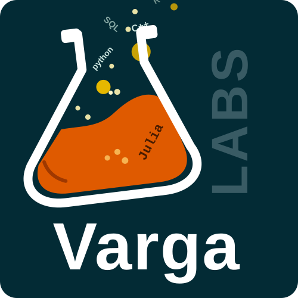
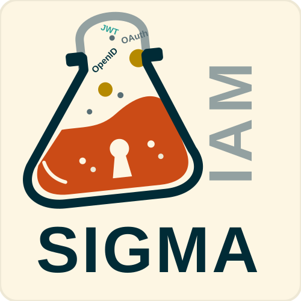
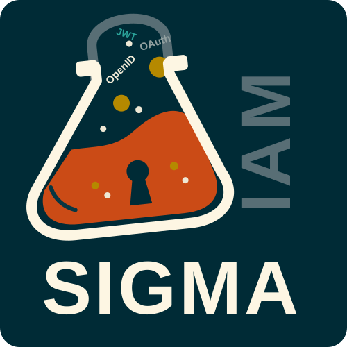

# VargaLABS

VargaLABS builds SIGMA, software for systems engineering and data work, from Toronto, Canada.

## SIGMA IAM and the licence service

{ .logo-light }
{ .logo-dark }

SIGMA software checks its licence with the VargaLABS licence service at `api.vargalabs.com`. The service issues
signed licence tokens, offers signed software updates, and receives error reports when you allow them.

You can link an installation to your GitHub, Google or LinkedIn account, so that we can connect your installations
to you and help you with your licence. We receive only your account ID, email address and display name, and never your password.

Read what we collect and how long we keep it in the [Privacy Policy](privacy/index.md). The rules for using
the service are in the [Terms of Service](terms/index.md).

## Contact

Email [info@vargalabs.com](mailto:info@vargalabs.com).
